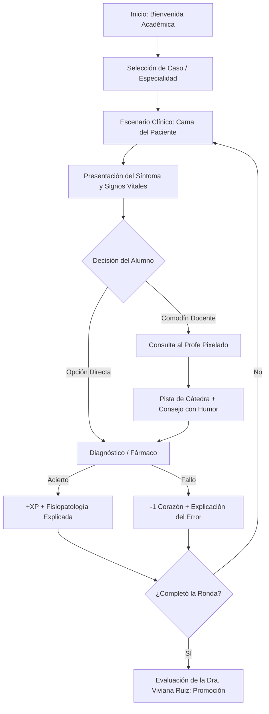

# 🩺 STORYBOARD: "MedikQuest - La Guardia del Conocimiento"
### Videojuego RPG Educativo para Estudiantes de Medicina (UPMS)

---

## 🎬 1. Flujo General del Jugador (User Journey)

---

## 🏥 2. Los 4 Actos del Storyboard (Pantalla por Pantalla)

### 📌 ACTO 1: "La Matrícula de Honor" (Pantalla de Inicio)
- **Visual:** Fachada de la Universidad María Serrana y recepción del hospital en pixel art 16-bit.
- **Narrativa:** El jugador ingresa su nombre y selecciona su avatar (Estudiante Hombre / Mujer con guardapolvo blanco y estetoscopio).
- **Aparición Docente:**
  - **Dra. Nidia Viviana Ruiz Prieto** (Coordinadora Académica):
  > *"¡Bienvenido al hospital, colega! Esta no es una prueba cualquiera: cada caso que resuelvas salvará a un paciente y te otorgará créditos para tu habilitación clínica. ¡A darlo todo!"*

---

### 📌 ACTO 2: "El Box de Urgencias" (Gameplay Principal)
- **Visual:** Sala de internación isométrica. A la izquierda el estudiante, en el centro la cama con el paciente acostado y el monitor ECG con pulso sonoro retro. A la derecha, el atril con el suero.
- **Mecánica de Pantalla:**
  1. **Ficha Clínica Superior:**
     - *Motivo de Consulta:* "Dolor abdominal agudo / Dificultad respiratoria".
     - *Signos Vitales:* PA: 140/90 mmHg | FC: 105 lpm | SatO2: 95% | Temp: 38.5°C.
  2. **Menú de Comandos Inferior (Estilo Pokémon / Final Fantasy):**
     - `[A] SEMIOLOGÍA:` Palpar, auscultar o percutir.
     - `[B] ESTUDIO:` Pedir ECG, Rx de Tórax o Laboratorio.
     - `[C] TRATAMIENTO:` Elegir conducta médica entre 4 opciones.
     - `[D] CONSULTAR AL PROFE:` Invocar el comodín de cátedra.

---

### 📌 ACTO 3: "La Interconsulta con el Profe" (El Comodín)
- **Visual:** Al presionar `[D]` o al fallar un intento, la música baja de volumen y salta el cuadro de diálogo retro con el avatar del docente especialista de esa materia:
  - **Caso Quirúrgico / Abdominal:** Salta el **Dr. Ernaldo René Amarilla**:
    > *"Colega, observe la posición antálgica del paciente. Antes de mandarlo a quirófano, ¿ya descartó apendicitis palpando el punto de McBurney?"*
  - **Caso de Urgencias / Prácticas:** Salta la **Dra. Antonella Antico**:
    > *"¡Cuidado con la saturación de oxígeno! Si baja de 92%, el primer paso no es el fármaco, es asegurar la vía aérea."*
  - **Caso Histológico / Biopsia:** Salta la **Dra. Valenzuela**:
    > *"Fíjese en la membrana basal... ese epitelio no es estratificado, es un clásico pseudoestratificado respiratorio."*

---

### 📌 ACTO 4: "El Pase de Guardia" (Feedback y Promoción)
- **Visual:** Sala de ateneo médico con los profesores aplaudiendo.
- **Resultados:**
  - Porcentaje de aciertos clínicos.
  - XP obtenida y nivel alcanzado (*De Alumno Practicante a Médico Interno*).
  - **Justificación Científica:** Un panel desplegable con la bibliografía oficial de la cátedra que explica por qué la opción correcta era la indicada según las guías clínicas.

---

## 🎮 3. Estructura de Niveles por Materias de 1er Año

| Nivel | Materia | Jefe de Cátedra Pixelado | Habilidad a Desarrollar |
| :--- | :--- | :--- | :--- |
| **Nivel 1** | **Anatomía Humana** | Dr. Rivas / Dr. Amarilla | Planos, huesos, músculos y trayectos nerviosos. |
| **Nivel 2** | **Histología y Biología** | Dra. Valenzuela | Identificación de tejidos y fisiología celular. |
| **Nivel 3** | **Bioquímica Médica** | Cátedra de Bioquímica | Enzimas, cascadas metabólicas y valores de laboratorio. |
| **Nivel 4** | **Prácticas Médicas I** | Dra. Antonella Antico | Triage, toma de presión, signos vitales y primeros auxilios. |
| **Jefe Final**| **Examen Integrador** | Dra. Viviana Ruiz | Caso complejo multidisciplinario de fin de semestre. |

---

## 🛠️ 4. Arquitectura Tecnológica para Ejecución Local
- **100% Web Nativo:** HTML5 Canvas + Vanilla JS + CSS Grid (corre con doble clic en cualquier máquina o TV Kiosk sin instalar Node.js ni bases de datos externas).
- **Banco de Casos Desacoplado:** Archivo [`preguntas.js`](file:///c:/ENTORNO%20LOCAL/NetAlertX/MedikQuest/preguntas.js) editable en texto plano para que cualquier profesor pueda redactar 20 casos nuevos sin saber programar.
- **Persistencia:** Guarda el progreso, récords y nombres de los alumnos en el `localStorage` del navegador.
